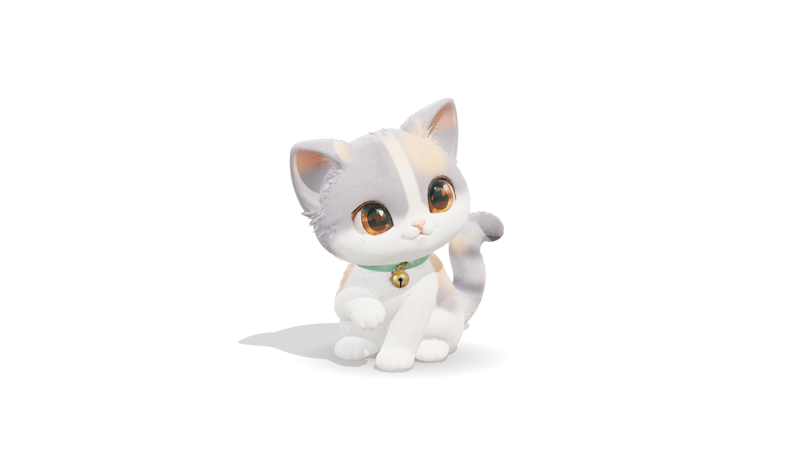

# 하리 라이브 배경화면

흰 바탕 가운데에 3D 아기 고양이 하리가 앉아 있고, 마우스에 반응하는 배경화면입니다.



| 동작 | 반응 |
|---|---|
| 커서가 다가가면 | 고개를 돌려 바라보고, 귀를 세우고, 꼬리 끝을 살랑임 |
| 머리·몸을 쓰다듬으면 | 눈을 감고 좋아함(^^), 볼 빨개짐, 귀를 눕힘, 꼬리를 세움, 하트 |
| 누르고 있으면 | 머리가 말랑하게 눌림 |
| 클릭하면 | 폴짝 점프 + 하트 |
| 빈 곳을 클릭하면 | 고개를 갸웃 |
| 가만히 두면 | 숨쉬기, 눈 깜빡임, 가끔 귀 쫑긋, 두리번거리기 |

시연 영상: [docs/demo.mp4](docs/demo.mp4)

## 폴더 구성

```
index.html            완성본 (모델·3D 엔진 포함, 인터넷 없이 동작) ← 배경화면 앱에 이 파일을 지정
src/main.js           자동 뼈대(머리·귀·꼬리), 눈꺼풀, 마우스 반응 코드
src/shell.html        페이지 틀 (스타일, 안내 문구, 출처 표기)
assets/character.glb  3D 모델 (단순화·압축본)
build.mjs             src + assets → index.html 묶는 스크립트
server.mjs            Railway 배포용 정적 서버 (npm start)
docs/                 미리보기 이미지와 시연 영상
CREDITS.md            3D 모델 출처·라이선스
```

## 배경화면으로 쓰기

| OS | 앱 (무료) | 방법 |
|---|---|---|
| Windows | Lively Wallpaper | `+` (배경화면 추가) → `index.html` 파일 선택 |
| Mac | Plash | 메뉴바 아이콘 → Add Website → `index.html` 경로 지정 |

- 배포한 주소로 쓸 때는 주소 끝에 `#wallpaper` 를 붙이면 안내 문구와 출처 표기가 숨겨집니다.
- Mac의 Plash는 바탕화면 창이 마우스 움직임을 받지 못해 반응이 제한됩니다.

## 코드 수정 후 다시 만들기

Node.js 18 이상이 필요합니다.

```bash
npm install
npm run build     # index.html 새로 생성
```

## 조절하기 (src/main.js)

| 항목 | 위치 |
|---|---|
| 평소 고개 방향 | `HEAD_REST = { yaw, pitch, roll }` (라디안. 0으로 두면 원본처럼 왼쪽 위를 올려다봄) |
| 고개 돌리는 한계 | `LOOK = { yaw, up, down, tilt }` (라디안. 키우면 더 많이 돌지만 목 주변이 늘어날 수 있음) |
| 화면 속 크기 | `frameCamera()` 의 `4.5`, `3.6` (작을수록 크게 보임) |
| 눈꺼풀 위치·크기 | `EYES` (모델 좌표 기준 눈 중심과 반지름) |
| 쓰다듬기 민감도 | `st.pet` 계산 부분 (`dt * 1.3`) |
| 점프 높이 | `doClick()` 의 `st.vy = 4.4` |

## Railway 배포

`package.json` 이 있어 Railway 가 Node 앱으로 인식합니다. 배포 때 `npm run build` 로 index.html 을 만들고
`npm start`(server.mjs)로 띄웁니다. 별도 설정은 필요 없습니다.

```bash
git remote add origin https://github.com/<내 계정>/hari-wallpaper.git
git push -u origin main
```

1. railway.com → New Project → Deploy from GitHub repo → hari-wallpaper 선택
2. 배포가 끝나면 서비스 → Settings → Networking → Generate Domain
3. 배경화면 앱에는 `https://<생성된 주소>/#wallpaper` 를 넣기

로컬에서 미리 확인: `npm install` → `npm run build` → `npm start` → http://localhost:3000

## 출처

3D 모델은 Cato Berg 님의 "Chibi Kitten - dilute calico recolor (Hari)" (CC BY 4.0) 입니다. 자세한 내용은 [CREDITS.md](CREDITS.md) 를 보세요.
